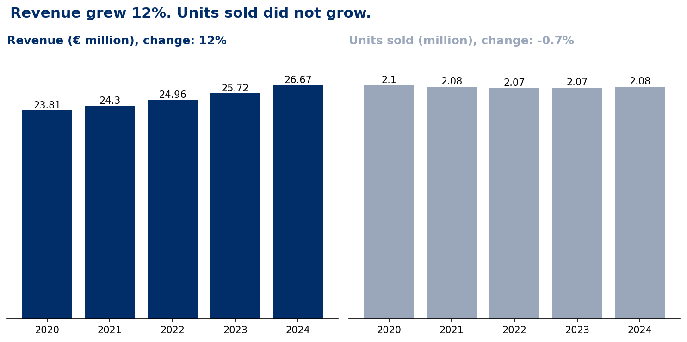
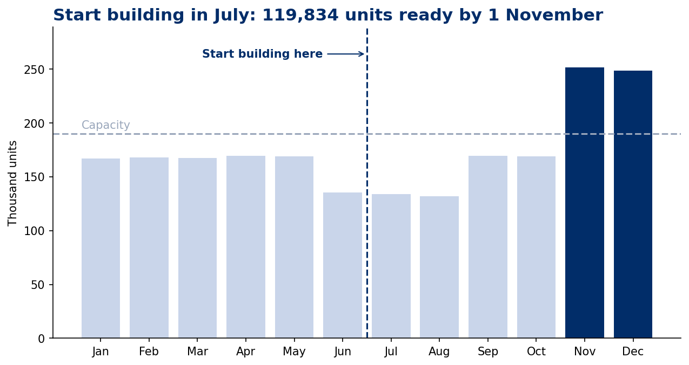

# Revenue grew 12%, but units sold stayed flat. Four decisions from 60 messy Excel tabs

Python (pandas, matplotlib) · 396,978 order lines from 60 Excel tabs, 2020 to 2024.

> **Executive summary**
>
> La Widgeterie makes 20 industrial parts and sells them to 275 wholesalers across France. Its managers faced four decisions: whether to renew a sales bonus plan, how to prepare production for the busiest months, whether to drop one part, and whether to protect the company against a wholesaler at risk of bankruptcy. The answers were buried in five years of sales data across 60 messy Excel tabs. Taking the role of a supply chain analyst, I cleaned and combined the data in Python and used it to evaluate each decision.
>
> **My recommendation to the COO:** do not renew the €250K-a-year sales bonus plan or increase it to €400K. Revenue grew 12% from 2020 to 2024, but units sold did not grow after the plan started in 2022: 2.09M units a year before the plan versus 2.07M after. The revenue growth came from a higher average price per unit, not from selling more parts.
>
> For the other three decisions, sign the €15K backup agreement with Payet, another wholesaler in Carpentier's city: Carpentier represents only 2.4% of company revenue but 37.6% of revenue in its region, and the agreement lowers the expected loss by €8,733 a year, its cost included. Start building stock in July so 119,834 units are ready by 1 November. Keep SKU-9325: dropping it saves €150K a year but loses €262K of margin.

## The four decisions

To answer the four decisions, I asked: Did we sell more units after the bonus plan started? When must the plant start building stock? What would we really lose by dropping SKU-9325? How exposed are we if Carpentier fails?

### 1. Don't renew the sales bonus plan: units sold did not grow

The plan should not be renewed, and its budget should not rise to €400K. Since it started in 2022, La Widgeterie has sold slightly fewer units a year, not more: 2,074,701 on average from 2022 to 2024, against 2,088,694 in 2020 and 2021. Over those three years, the plan cost €750,000.

The 12% growth the head of sales points to is real in revenue (2020 to 2024), but units sold fell 0.7%. The difference is price: the average price per unit rose 12.8%, from €11.36 to €12.82. If sales needs an incentive, measure it in units sold: revenue rises with prices on its own. This data can't tell what volume would have been without the plan, for example if the market shrank.

### 2. Start building stock in July: 119,834 units ready by 1 November

The plant can start building stock as late as July, and must have 119,834 units in the warehouse on 1 November. November and December are the only months above the plant's capacity of 190,000 units a month: on average, they need 61,480 and 58,354 units more than the plant can make.

Walking back from December, the spare capacity of August to October is not enough on its own: 19,897 units must already be in stock on 1 August.

### 3. Keep SKU-9325: dropping it saves €150K a year but loses €262K of margin

Keep SKU-9325. Dropping it would cost €112,039 more in margin each year than it saves.

Dropping it would save €150,000 a year, but the company would lose €262,039 of margin: €112,314 on SKU-9325 itself and €149,725 on other parts that four wholesalers would move to a competitor.

SKU-9325 alone represents only 1.4% of revenue, so dropping it looks like a cheap cut. But four wholesalers buy it in the same orders as other parts, and they said they would move every order that includes it, with €499,084 of sales of other parts.

### 4. Sign the backup agreement with Payet: Carpentier is 37.6% of its region

The backup agreement with Payet, another wholesaler in Carpentier's city, is worth its €15,000 a year. Carpentier is only 2.4% of La Widgeterie's revenue, but 37.6% of Bourgogne-Franche-Comté. In that region, it buys more than 40% of the sales of 7 of the 20 parts (up to 45.6% for SKU-2972).

With a 25% chance that Carpentier fails within a year, the expected cost is €33,227 of lost margin without the agreement, and €24,494 with it, including its price. The agreement stays worth signing as long as the chance of failure is above 15.8%.

## Recommendations

| Priority | Action | Expected impact | Metric to track | Owner |
| --- | --- | --- | --- | --- |
| 1 | Don't renew the sales bonus plan this year, and don't raise it to €400K | Saves €250,000 a year (€400,000 with the budget the head of sales asked for), on a plan with no increase in units sold | Units sold per year, against 2,088,694 (the average before the plan) | COO, with the head of sales |
| 2 | Sign the €15,000 backup agreement with Payet now | Expected loss €8,733 a year lower (€24,494 instead of €33,227), and 80% of Carpentier's business kept if it fails: it is 37.6% of Bourgogne-Franche-Comté | Carpentier's payment delays, and the insurer's failure estimate: below 15.8%, the agreement is no longer worth renewing | CFO, with the head of sales |
| 3 | Build 19,897 units in July, then run the plant at full capacity from August to October, to have 119,834 units in stock on 1 November | November and December orders delivered on time without overtime, and no stock held before July | Late deliveries and overtime hours in November and December, and stock against plan on the 1st of each month | Plant manager |
| 4 | Reject the proposal to retire SKU-9325 | Keeps €262,039 of margin a year, €112,039 more than the cut would save, and the four wholesalers' €499,084 of other orders | Orders and margin from the four wholesalers | CFO, with the head of sales |

## Assumptions, limits and what needs further investigation

**Business inputs**

- The margin is 30% of sales for every part (the company's figure).
- The stock plan uses the average of each month over the five years (the COO's rule).

**Assumptions**

- The order files contain every order from 2020 to 2024.
- Next year will look like 2024: decisions 3 and 4 use 2024, the last full year.
- The 1.65% of missing sales are estimated as quantity × that part's average price that year.

**Limits**

- These are orders from wholesalers, not what end customers buy.
- The savings, the plant capacity, the margin, the chance of failure and the survey answers come from the business, not from the data.

**What needs further investigation**

- What did the bonus plan reward (targets, products, customers), and how did the market move? This would show whether units would have fallen without it.
- Why has volume not grown in five years?
- Would the four wholesalers really move their orders if SKU-9325 were dropped?
- Can SKU-9325's handling cost be cut without dropping the part? The €150,000 of savings would still be worth having.
- Which other wholesalers are, like Carpentier, small for the company but large in their region?

## About the data

The 396,978 order lines came from 60 monthly Excel tabs with typos and gaps: 6,541 sales were missing (1.65%), and the 20 part codes were written 60 different ways. I filled the missing sales with each part's average price that year, and checked that no order was lost when adding the regions. The data work and the formulas are in the [technical documentation](TECHNICAL_README.md), and the full analysis is in the [notebook](notebooks/widgeterie_decisions.ipynb) in this repository.

